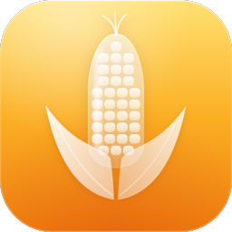
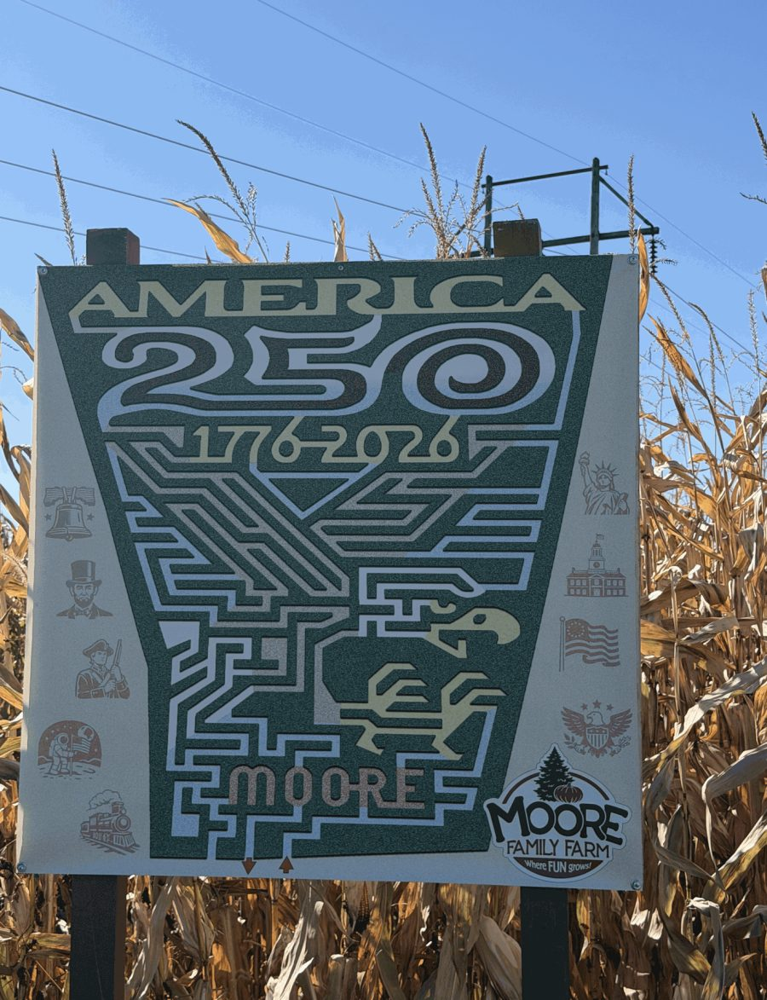
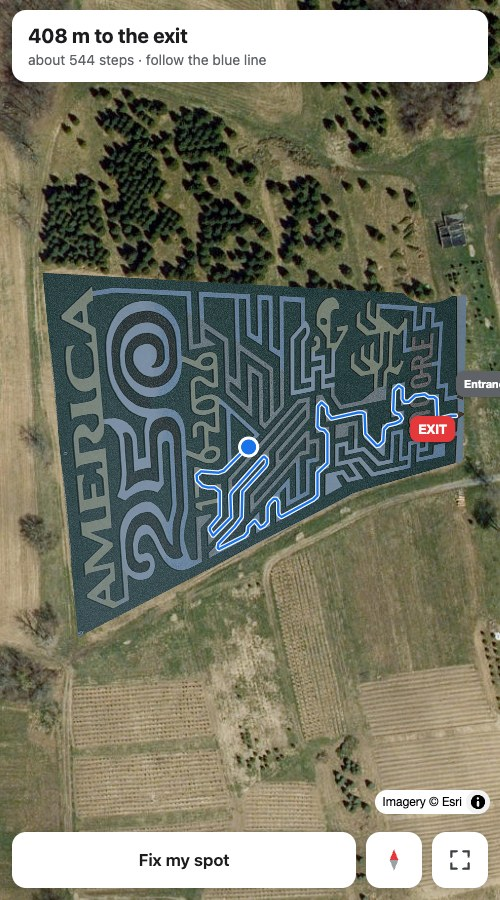

<div align="center">



# MaizeKit

Turn a photo of a corn maze map into a phone app that shows where you are and the way out.

[**Try a live maze**](https://maizekit.github.io/m/moore-family-farm/) · [Website](https://maizekit.github.io/) · [Documentation](https://maizekit.github.io/docs/)

&nbsp;&nbsp;

<sub>The map at the entrance, and the same maze in MaizeKit.</sub>

</div>

## Overview

Visitors scan a QR code at the entrance, allow location, and get:

- a blue dot showing where they are in the maze
- a line to the exit from wherever they're standing
- **Fix my spot**, for when GPS puts them a row off

Everything runs as static files on GitHub Pages. There's no server and no accounts, and
location never leaves the phone.

## Getting started

**Run a corn maze?** [Send us your map](https://github.com/MaizeKit/MaizeKit/issues/new?template=add-maze.yml):
a photo of the sign at the entrance or an aerial shot, plus your address. We'll set it up
and send you the link. It's free.

**Adding one yourself?** Each maze is a folder with two files:

```
m/your-farm/
├── sign-photo.png      a straight-on photo of the maze map
└── maze.config.json    where the map sits, on the photo and on the ground
```

Open a pull request with it. The build checks the config and that the exit can be reached,
and once merged the maze is live at `maizekit.github.io/m/your-farm/`. Each season, swap in
the new photo and config; the link stays the same. See [Configuration](https://maizekit.github.io/docs/configuration/).

## Entrance sign

Every maze gets a printable sign with a QR code at `/m/your-farm/sign.html`.

## Repository

```
app/       the maze app every maze shares, and build.py, which turns a photo into a map
m/         one folder per maze
docs/      the documentation site, written from the code by docs/build.py
brand/     icon, badge and images
index.html the website
```

Every push to `main` builds all mazes and the docs and publishes them to
[maizekit.github.io](https://maizekit.github.io/).

---

<sub>MIT licensed. Bundles [MapLibre GL JS](https://github.com/maplibre/maplibre-gl-js) (BSD-3-Clause) and [qrcode-generator](https://github.com/kazuhikoarase/qrcode-generator) (MIT). Maze photos in `m/` belong to their farms, which aren't affiliated with MaizeKit.</sub>
